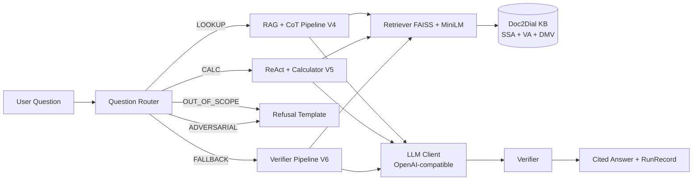

# PolicyPilot

A citizen-services question-answering assistant over public government documents (Doc2Dial: SSA, VA, DMV),
built as a Prompt Engineering course project. PolicyPilot combines role prompting, few-shot examples,
Chain-of-Thought, AutoCoT, RAG, and a ReAct agent with tool use to produce cited, computed answers.

## Architecture



## Setup (5 commands)

```bash
git clone <repo-url> && cd policypilot
cp .env.example .env          # fill in your API keys
make setup                    # pip install -r requirements.txt
make data                     # download datasets, build eval + router sets
make index                    # embed Doc2Dial docs, build FAISS index
```

Then run the app:
```bash
make app                      # streamlit run src/policypilot/app/main.py
```

## Reproducing tables and figures

| Table / Figure | Command |
|---|---|
| Tab 1 Datasets | see DATASETS.md |
| Tab 2 Prompt versions | `cat prompts/*.yaml` |
| Tab 3 Token budget | `make token-budget` |
| Fig 2 Ablation | `make eval-dev` then `make report` |
| Fig 4–5 Sweeps | `make sweep` then `make report` |
| Tab 4 Chunking | `make sweep` (chunking grid) |
| Fig 8 Router | `make router-cv && make router-final` |
| All test results | `make eval-test` (run ONCE, on frozen prompts) |
| All report assets | `make report` |

## Folder map

```
policypilot/
  AGENTS.md          Agent rules and hard constraints
  README.md          This file
  Makefile           All make targets
  requirements.txt   Pinned dependencies
  .env.example       LLM key placeholders
  configs/           default.yaml, sweeps.yaml
  data/public/       Downloaded raw datasets (read-only after D1)
  data/processed/    Doc2Dial chunks and metadata
  data/index/        FAISS index (git-ignored)
  prompts/           V0–V6, judge, verifier YAML files
  src/policypilot/   Main package
  eval/              Golden eval sets (read-only after D1)
  router/data/       Router training data (read-only after D1)
  results/           All experiment outputs
  scripts/           Evaluation, sweep, report scripts
  tests/             pytest suite
  docs/              Architecture, iteration log, schema notes
  report/            LaTeX/Markdown draft and assets
```

## Limitations

- Single corpus (US government docs), possibly seen in LLM training.
- Test set: 200 questions — wide confidence intervals.
- LLM judge noise mitigated by human audit + kappa.
- English only, no multi-turn memory.
- See report Chapter 7 for full limitations.
